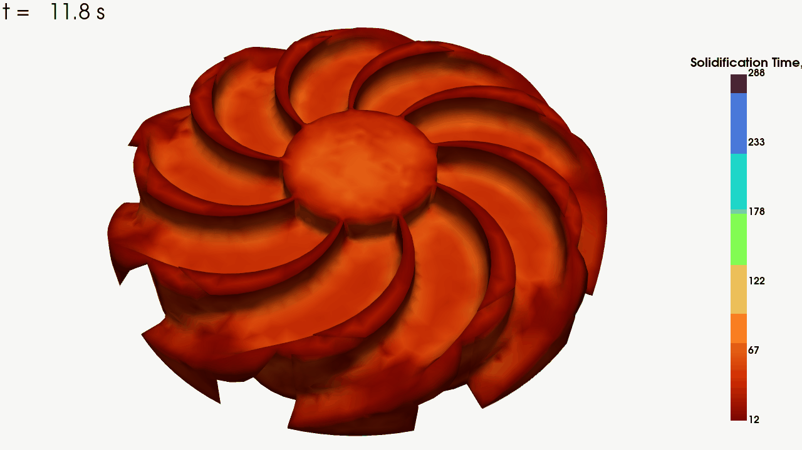
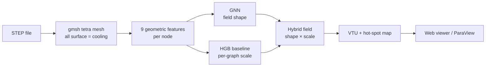
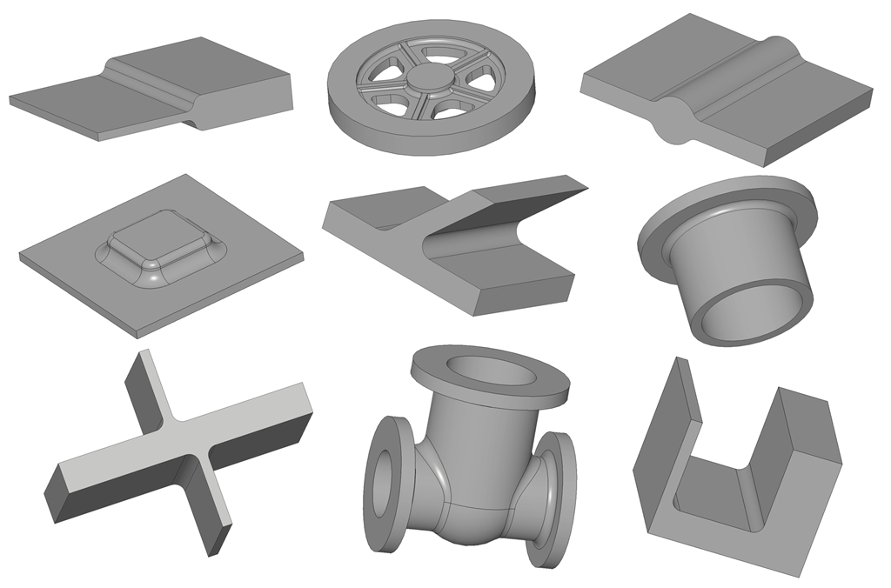
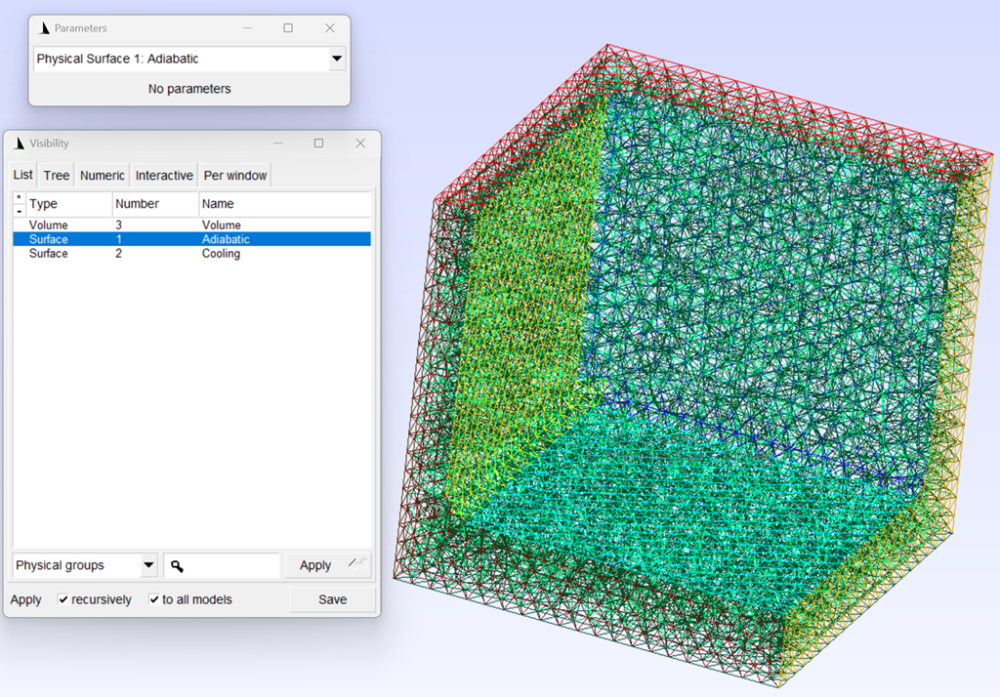

# Casting Solidification GNN

A graph neural network that predicts, for a metal casting, **how long every point takes to solidify** and **where the last-to-freeze hot spots are** - the zones that shrink and form porosity. It works directly on a real casting's STEP file and generalizes from 42 simple training shapes to parts it has never seen.

<p align="center">
  <br>
  <em>The web viewer replaying a predicted solidification front: already-frozen material fades to a ghost, still-liquid metal stays opaque, and the last pocket to solidify is the hot spot.</em>
</p>

Casting engineers need to know where a part solidifies last so they can place feeders and chills before cutting a mould. The physical answer comes from a thermal FEM simulation, which is accurate but slow to set up per part. This model learns that mapping from geometry once and then answers in seconds.

> [!NOTE]
> The whole design is built so the model never sees a filename or a shape label - only the mesh and its cooling boundary. That is what lets a network trained on lab primitives transfer to production castings.

## Results

Numbers below are on **held-out geometry families** (whole shape types the model never trained on), which is the honest test of generalization.

| Metric | Physics-feature baseline | **Hybrid GNN (this repo)** |
|---|---|---|
| Hot-spot agreement (top-10% overlap) | 0.73 | **0.93** |
| Mean absolute error | ~9.2 s | **~8.7 s** |
| Predicted / true field std | collapsed | **~1.0** |

On fully sand-cooled parts (the regime real castings fall into) the hybrid reaches MAE ~5.9 s and 0.94 hot-spot agreement. The earlier plain GNN suffered from *variance collapse*. It smeared the field toward the mean and lost the hot spots entirely. Fixing that was the core of the project (see [How it works](#how-it-works)).

Two real castings, meshed from raw STEP and predicted end to end:

| Part | Nodes | Total solidification time |
|---|---|---|
| Ring | 8,478 | 30 s |
| Wheel | 10,322 | 96 s |

## How it works

The prediction pipeline for a real casting:



### Features the model reads

Every node carries **9 features**, all in millimetres and invariant to how the part is positioned or rotated. None of them can be derived from the filename - that constraint is what makes the model transfer.

- `geodesic_d_cool` - distance to the nearest cooling surface, measured *through the metal* (Dijkstra on the mesh), not straight-line
- `d_surf`, `d_adiab` - distance to the outer surface and to any insulated face
- `is_cooling`, `is_adiabatic`, `is_interior` - boundary role of the node
- `volume_mm3`, `surface_area_mm2`, `cooling_area_frac` - local size and how much of the nearby surface actually cools

The target is the physical one: the time each node's temperature crosses the solidus (1120 °C, poured at 1380 °C). The network trains on standardized `log1p` of that time.

### The network

An encode-process-decode **MeshGraphNet** (12 message-passing blocks, hidden width 128) over a k-nearest-neighbour graph (k = 16) built from node positions. Edges carry the relative offset and distance between neighbours, so the same weights apply at any mesh resolution.

<p align="center">
  <br>
  <em>A slice of the geometry set - plates, wedges, crosses, rings, flanges, a valve tee, a wheel. 42 shape families, 9,710 castings in total.</em>
</p>

### Shape from the GNN, scale from a baseline

Left alone, the GNN reproduces the *shape* of the solidification field almost perfectly (per-part correlation ~0.98) but drifts on the absolute *level*. A gradient-boosted baseline on the same 9 features gets the per-part magnitude right but has no spatial detail. The hybrid keeps the GNN's deviations from its own mean and re-anchors the level to the baseline:

```
pred_i = gnn_i - mean(gnn) + mean(baseline)
```

That one line keeps the GNN's hot-spot resolution while removing its offset, and it beats both parent models on every split. Code: [`src/hybrid.py`](src/hybrid.py).

### Boundary conditions

Each training mesh tags its surfaces as **Cooling** (sand-mould heat loss) or **Adiabatic** (insulated), plus the **Volume**. Adiabatic faces were added on purpose during data generation to force the model to learn from boundary *conditions* rather than from the shape outline. Same reason as everywhere else: transfer to parts it has never seen. Real castings are treated as fully cooled (all outer surface = cooling), which is the regime the hybrid handles best.

<p align="center">
  <br>
  <em>A tetrahedral mesh with its physical groups: Volume, Adiabatic, Cooling.</em>
</p>

## The data-recovery story

> [!WARNING]
> This one nearly sank the project, and it is the most useful thing in the repo for anyone doing FEM-to-ML work.

The ground-truth temperatures come out of the FEniCSx/dolfinx solver in **DOF order**, which is scrambled relative to the **gmsh node order** that the mesh and all the geometric features use. About 60% of the per-node targets were silently paired with the wrong node. Every early model looked broken for no visible reason. The correlation between distance-to-cooling and solidification time sat near zero, when physics says it should be strong.

The fix was not to re-run any simulation (the temperatures themselves were correct) but to recover the per-part permutation between DOF order and node order and apply it once during dataset build. After the fix, that correlation jumped to ~0.9 and the models started learning. The recovery scripts live in [`tools/recovery/`](tools/recovery/), and `src/build_dataset.py` applies the saved permutations automatically.

## Web viewer

A local single-user app (trame + PyVista) for looking at a prediction:

```bash
python -m src.webapp     # → http://localhost:8080
```

Upload a STEP file and it meshes, predicts, and renders the field. Controls:

- **Time slider** - drag it and frozen regions fade to a ghost while still-liquid metal stays solid, so you watch the front collapse toward the hot spots
- **Hot-spots toggle** with adjustable size and cutoff
- **Generate GIF** - records the animation from whatever camera angle you set up (the clip at the top of this page was made this way)
- A summary panel with total time, hot-spot coordinates, and out-of-distribution warnings when a part is larger than anything in training

## Repository layout

```
src/
  step_mesh.py        STEP → gmsh tetrahedral mesh (all-surface cooling)
  msh_parse.py        read gmsh 2.2 meshes + physical groups
  geometry.py         geodesic / surface distances, local volume & area
  features.py         the 9 per-node features (training + inference paths)
  targets.py          per-node solidus-crossing time
  build_dataset.py    feature cache (applies node-order recovery)
  model_gnn.py        MeshGraphNet (encode-process-decode)
  graph_build.py      kNN graph + edge features
  train_gnn.py        GNN training
  baseline.py         gradient-boosted physics baseline
  hybrid.py           shape × scale combiner
  ood.py              out-of-distribution size check
  predict_casting.py  end-to-end: STEP → prediction → VTU + summary
  viz.py / webapp.py  PyVista helpers + the trame web app
tools/recovery/       dolfinx DOF ↔ gmsh node-order recovery (run once)
tests/                70 tests
```

## Getting started

The project runs in a conda environment with PyTorch 2.3 + PyTorch Geometric, plus gmsh, meshio, and the PyVista/trame viewer stack.

```bash
conda create -n casting-gnn python=3.11
conda activate casting-gnn
pip install -r requirements.txt
```

Node-order recovery (only needed if you rebuild the dataset from raw simulations) uses a separate environment with dolfinx 0.11.

> [!IMPORTANT]
> Running the models needs the trained artifacts (GNN checkpoint, baseline, normalization stats). They are not in the repo because they are large and regenerable. The code paths and shapes are all here to read and to retrain from your own simulation data.

## Predict on a real casting

```bash
python -m src.predict_casting /path/to/part.step --out-dir runs/castings
```

This writes `part.vtu` (open in ParaView; point fields `solidification_time` and `hotspot`) and `part_summary.txt` (total time, hot-spot coordinates, any size warnings). All outer surface is treated as sand-mould cooling.

## Rebuild the dataset / retrain

```bash
# 1) node-order recovery perms (dolfinx env, one time)
python tools/recovery/compute_perms.py

# 2) feature cache
python -m src.build_dataset --workers 12 --out-dir data/features_v2

# 3) baseline, then GNN
python -c "from src.run_baseline import run; run(features_dir='data/features_v2', out_dir='runs/baseline_v2')"
python -c "from src.train_gnn import train; train(n_blocks=12, batch_size=2)"
```

## Tests

```bash
pytest -q     # 70 tests
```

They cover the geometry math, feature construction, the node-order recovery invariant, the model forward pass, the hybrid, the inference driver, and the viewer helpers.

## Status

The end-to-end pipeline works: FEM ground truth → recovered dataset → baseline + GNN → hybrid → real STEP inference → web viewer. Quantitative validation against a fresh FEniCSx run on real parts is the next step. Multi-body STEP assemblies are lumped into a single solid for now, which suits single-piece castings.

Trained on a Xeon workstation with one RTX 3060 (12 GB); a full prediction on a real part takes seconds to a couple of minutes.
