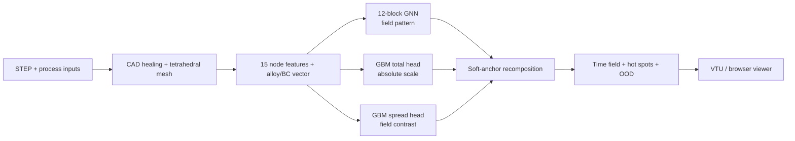

# Casting Solidification GNN

A graph neural network surrogate for **rapid solidification screening** of metal castings.
Given a STEP model, alloy and mold condition, the pipeline predicts a per-node
solidification-time field and identifies the last-to-solidify regions.

It is designed to provide an early engineering estimate before a full simulation study.
It is **not** a replacement for a calibrated process simulation or physical validation.
Hot spots are indicators of feeding difficulty and shrinkage risk; they are not direct
porosity labels.

<p align="center">
  <br>
  <em>Predicted solidification playback: already-solidified material becomes translucent while the remaining liquid region contracts toward the hot spot.</em>
</p>

## Current status

- Production model stack: **v5.1 hybrid**, frozen July 31, 2026.
- Inputs: STEP geometry in millimeters, named alloy and mold properties, and optional
  casting/chill/sleeve body roles.
- Outputs: per-node solidification time, total time, top-decile hot-spot mask, OOD warnings
  and a scoped shrinkage-screening layer.
- Browser workflow: **FoundryFlash**, a working prelaunch prototype for upload, meshing and
  interactive 3D review. It is not publicly deployed.
- Intended positioning: **rapid solidification screening** only.

## Evidence, separated by evaluation regime

Results from different datasets are not interchangeable. The small primitive regime and the
later real-geometry evaluation have very different time scales.

| Evaluation | n | Nodal MAE | Hot-spot overlap | What it establishes |
|---|---:|---:|---:|---|
| Held-out primitive geometry families | family split | **4.26 s** | **0.917** | Generalization across unseen synthetic shape families in the original regime |
| Unseen real, single-body casting geometry | 6 | **80.3 s median** | **0.738 median** | Geometry generalization against a shared-mesh FEniCSx reference |
| Unseen real sleeve assemblies | 2 | **443.7 s median** | **0.932 median** | Good hot-region ranking, but excessive field smoothing and poor absolute calibration |

The real-geometry study started with 10 production casting CAD models. Two could not be
meshed because of self-intersecting B-reps, leaving eight scored parts. One single-body part
had only **0.035** hot-spot overlap, so the median must not be read as a guarantee.

> [!IMPORTANT]
> Training and real-geometry reference fields share the same FEniCSx heat-transfer model,
> material database and boundary assumptions. These results measure surrogate generalization
> to new geometry. They do **not** establish physical accuracy against instrumented castings.

Hot-spot overlap is the overlap of the predicted and reference top 10% latest-solidifying
nodes. A value of 1.0 means the two node sets coincide.

## How v5.1 works



The graph network follows the encode-process-decode pattern introduced by
[MeshGraphNets](https://arxiv.org/abs/2010.03409). Mesh edges and nearby-node connections
form a union graph. Twelve message-passing blocks with hidden width 128 predict the spatial
field pattern.

The graph network alone is not the production predictor. Two
`HistGradientBoostingRegressor` heads estimate total solidification time and field spread.
`src/hybrid.py::hybrid_field_soft` maps the GNN field to those two graph-level targets while
clipping negative time. The production weights are `w_total=1.0` and `w_std=4.0`.

### Features and conditioning

The v5.1 checkpoint consumes 15 per-node features:

- distance through the mesh to cooling and adiabatic boundaries;
- surface, interior, cooling and adiabatic flags;
- global volume, surface area and cooling-area fraction;
- local volume-to-surface measures at 5, 15 and 40 mm radii;
- boundary-extraction and exothermic-influence channels.

A five-value graph vector conditions the network on alloy and boundary properties through
FiLM layers. The public tables contain 12 named iron and steel grades, two mold labels and
example chill/sleeve inputs. The two mold rows currently share the same interim thermal
properties; selecting between them does not yet change a prediction.

## Data

Development began with **9,710** thermal simulations across **42** geometry families. A
later **4,727-case** dataset expanded the problem to multiple alloys and boundary-condition
regimes, including sand cooling, chills and sleeves. Reference fields were generated with
[FEniCSx](https://fenicsproject.org/) using an enthalpy-based conduction model with latent
heat.

The repository does not include the raw simulation corpus or trained weights. The public
source is a curated implementation snapshot for technical review; inference requires the
matching private model package.

## The data-recovery lesson

The most consequential defect was not in the neural network. Solver temperatures were in
degree-of-freedom order, while coordinates and geometric features were in gmsh node order.
About 60% of nodal targets were silently attached to the wrong positions.

The recovery scripts in [`tools/recovery/`](tools/recovery/) reconstruct the permutation
between those orderings, and `src/build_dataset.py` applies it while building graph data.
For simulation-to-ML work, this is the key lesson: verify local data identity across every
solver/mesh interface before tuning a model.

## Repository map

```text
src/
  model_gnn.py          GNN, FiLM and optional derivative heads
  features.py           v2-v5 geometry and boundary features
  hybrid.py             scale/spread recomposition
  predict_casting.py    STEP-to-field orchestration
  assembly.py           multi-body roles and contact patches
  shrinkage.py          scoped post-processing and confidence flags
  mesh_cache.py         content-addressed meshing cache
  train_*.py            training and fine-tuning entry points
tools/
  recovery/             solver-DOF to mesh-node recovery
  doe/                   public property and density-meshing helpers
data/properties/         compact public material/BC tables
tests/                   deterministic public unit tests
```

## Installation

Create a Python 3.11 environment, install a PyTorch build suitable for your CPU/CUDA setup,
then install the remaining dependencies:

```bash
python -m venv .venv
source .venv/bin/activate
pip install -r requirements.txt
```

Run the public tests:

```bash
pytest -q
```

Current public snapshot: **306 passed, 7 skipped**. The skipped cases require optional
runtime capabilities unavailable in the basic test environment.

The committed source paths expect the following private artifacts for v5.1 inference:

```text
runs/ft3_stage1/ckpt_ep021.pt
runs/ft3_gbm/hgb_v3.joblib
runs/ft3_gbm/hgb_std_v2.joblib
data/features_v2/ood_ranges.json
```

They are intentionally excluded from this public repository. See [`MODEL_CARD.md`](MODEL_CARD.md)
for the evaluation scope and operating limits.

## Practical limits

- Pure conduction with latent heat: no mold filling, fluid flow, gas, stress or distortion.
- CAD healing and tetrahedral meshing dominate end-to-end latency and may fail on invalid
  solids. GNN inference itself takes seconds after meshing on the development GPU.
- OOD checks cover geometry size and distance to cooling, but are not a calibrated uncertainty
  estimate.
- Assemblies may locate hot regions well while underestimating field contrast.
- The Niyama-style proxy is marked low-confidence for chill-bearing inputs.
- Physical validation against measured castings is the next launch-critical study.

## Author

**Eugen Miknevic** — independent foundry engineer<br>
Contact: **eugenmiknevic@gmail.com**
