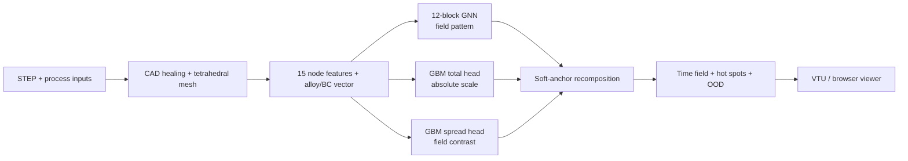

# Casting solidification GNN

A graph neural network surrogate for screening how metal castings solidify. Given a STEP
model, an alloy and a mold condition, the pipeline predicts the solidification time at every
mesh node and marks the regions that freeze last.

It gives an engineering estimate early in design, before anyone sets up a full simulation. It
does not replace a calibrated process simulation or physical validation. Hot spots mark feeding
difficulty and shrinkage risk; they are not porosity labels.

<p align="center">
  <br>
  <em>Predicted solidification playback. Solidified material turns translucent while the
  remaining liquid contracts toward the hot spot.</em>
</p>

## Model weights

The trained v5.1 weights are published on Hugging Face as CastSolid GNN, under Apache-2.0:

**[huggingface.co/eugenmik/castsolid-gnn](https://huggingface.co/eugenmik/castsolid-gnn)**

The Hugging Face repository is self-contained. It has the weights (safetensors and skops, no
pickles), this source code, the model card with the full evaluation, and a quick start. To run
predictions from a clone of this GitHub repository instead, download the weights into
`weights/`:

```bash
hf download eugenmik/castsolid-gnn --include "weights/*" --local-dir .
```

## Current status

- The production stack is the v5.1 hybrid, frozen on 31 July 2026.
- Inputs: STEP geometry in millimetres, a named alloy and mold, and optional roles for casting,
  chill and sleeve bodies.
- Outputs: solidification time per node, total time, a top-decile hot-spot mask, OOD warnings
  and a shrinkage screening layer with an explicit confidence label.
- A local browser viewer (`python -m src.webapp`) handles upload, meshing and interactive 3D
  review. FoundryFlash, a prelaunch browser prototype built on the same stack, is not publicly deployed.

## Evidence, split by evaluation regime

Numbers from different datasets cannot be compared directly. The primitive regime and the
later real-geometry evaluation work on very different time scales.

| Evaluation | n | Nodal MAE | Hot-spot overlap | What it shows |
|---|---:|---:|---:|---|
| Held-out primitive geometry families | family split | 4.26 s | 0.917 | Generalization to unseen synthetic shape families in the original regime |
| Unseen real single-body castings | 6 | 80.3 s median | 0.738 median | Generalization to new real geometry against a FEniCSx reference on the same mesh |
| Unseen real sleeve assemblies | 2 | 443.7 s median | 0.932 median | Hot regions rank well, but the field is too smooth and the absolute times are off |

The real-geometry study started from 10 production CAD models. Two could not be meshed because
of self-intersecting B-reps, which left eight scored parts. One single-body part reached a
hot-spot overlap of only 0.035, so the median is not a guarantee for any single part.

> [!IMPORTANT]
> Training data and real-geometry references come from the same FEniCSx heat-transfer model,
> material database and boundary assumptions. These results measure how well the surrogate
> carries over to new geometry. They do not show physical accuracy against instrumented
> castings.

Hot-spot overlap compares the 10% of nodes that solidify last in the prediction and in the
reference. A value of 1.0 means the two sets are identical.

## How v5.1 works



The graph network uses the encode-process-decode design from
[MeshGraphNets](https://arxiv.org/abs/2010.03409). Mesh edges and k-nearest-neighbour edges
together form a union graph, and twelve message-passing blocks with hidden width 128 predict the
spatial pattern of the field.

The GNN is not the predictor on its own. Two `HistGradientBoostingRegressor` heads estimate the
total solidification time and the spread of the field. `src/hybrid.py::hybrid_field_soft` fits
the GNN field to both targets and clips negative times, with weights `w_total=1.0` and
`w_std=4.0`.

### Features and conditioning

The v5.1 checkpoint reads 15 features per node:

- distance through the mesh to cooling and adiabatic boundaries;
- surface, interior, cooling and adiabatic flags;
- part volume, surface area and cooling-area fraction;
- local volume-to-surface ratios at radii of 5, 15 and 40 mm;
- a chill heat-extraction channel and an exothermic-sleeve channel.

A vector of five numbers describes the alloy and the boundary, and conditions the network
through FiLM layers. The public tables hold 12 named iron and steel grades, two mold labels and
example chill and sleeve inputs. The two mold rows share the same interim thermal properties for
now, so choosing between them does not change a prediction.

## Data

Development started with 9,710 thermal simulations across 42 geometry families. A later set of
4,727 cases added multiple alloys and boundary regimes (sand cooling, chills and sleeves), and
500 more cases put virtual chill and sleeve patches on real part geometry. All reference fields
were generated with [FEniCSx](https://fenicsproject.org/) using an enthalpy-based conduction
model with latent heat.

<p align="center">
  
</p>

Neither this repository nor the Hugging Face release contains the raw simulation corpus.

## The node-order bug

The worst defect in the project was not in the neural network. Solver temperatures were stored
in degree-of-freedom order, while coordinates and geometric features were in gmsh node order.
About 60% of the nodal targets were silently attached to the wrong positions.

The recovery scripts in [`tools/recovery/`](tools/recovery/) rebuild the permutation between the
two orderings, and `src/build_dataset.py` applies it when it builds the graph data. If you work
on simulation-to-ML pipelines, check node identity across every solver and mesh interface before
you tune a model.

## Repository map

```text
src/
  model_gnn.py          GNN, FiLM and optional derivative heads
  features.py           v2 to v5 geometry and boundary features
  hybrid.py             scale and spread recomposition
  predict_casting.py    STEP-to-field orchestration
  release_io.py         safetensors/skops loading of the published weights
  assembly.py           multi-body roles and contact patches
  shrinkage.py          shrinkage screening and confidence flags
  mesh_cache.py         content-addressed meshing cache
  train_*.py            training and fine-tuning entry points
tools/
  recovery/             solver-DOF to mesh-node recovery
  doe/                  property loader and density-targeted meshing
  sleeves/              sleeve registry (vendor MEF for real products)
data/properties/        material, mold, chill and sleeve tables
tests/                  deterministic unit tests
```

## Installation

Create a Python 3.11 environment. Install PyTorch 2.3 and the matching `torch-cluster` wheel
for your CPU or CUDA setup, then the remaining dependencies:

```bash
python -m venv .venv
source .venv/bin/activate
pip install "torch==2.3.0" --index-url https://download.pytorch.org/whl/cpu
pip install torch-cluster -f https://data.pyg.org/whl/torch-2.3.0+cpu.html
pip install -r requirements.txt
pytest -q
```

With the weights in `weights/` (see above), run a prediction:

```bash
python -m src.predict_casting path/to/part.step --out-dir out --alloy EN-GJS-500-7
```

See [`MODEL_CARD.md`](MODEL_CARD.md) for the evaluation scope and operating limits, and the
[Hugging Face model card](https://huggingface.co/eugenmik/castsolid-gnn) for the
full description.

## Practical limits

- The physics is conduction with latent heat. There is no mold filling, fluid flow, gas, stress
  or distortion.
- CAD healing and tetrahedral meshing take most of the end-to-end time and can fail on invalid
  solids. Once a part is meshed, GNN inference takes seconds.
- OOD checks cover part size and distance to cooling. They are not a calibrated uncertainty
  estimate.
- On assemblies the model can locate the hot regions well while underestimating the contrast of
  the field.
- The Niyama proxy is marked low-confidence for inputs with chills.
- The next study that matters for launch is validation against measured castings.

## License

Apache License 2.0, see [LICENSE](LICENSE).

## Author

Eugen Miknevic, independent foundry engineer<br>
Contact: eugenmiknevic@gmail.com
