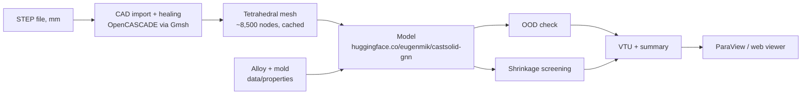

# Casting solidification GNN: the pipeline

This repository turns a CAD model of a casting into a predicted solidification field you can
open in ParaView. It reads a STEP file, heals the geometry, builds a tetrahedral mesh, runs the
trained surrogate model on that mesh, and writes the field together with hot spots,
out-of-distribution warnings and a shrinkage screening layer. A small local web viewer does the
same from a browser.

The model itself, with its architecture, training data, evaluation and limitations, is published
and documented on Hugging Face. The code downloads the weights from there on first use:

**[huggingface.co/eugenmik/castsolid-gnn](https://huggingface.co/eugenmik/castsolid-gnn)**

<p align="center">
  <br>
  <em>A predicted field played back in the viewer. Solidified material turns translucent while
  the remaining liquid contracts toward the hot spot.</em>
</p>

## What the pipeline does



1. CAD import and healing (`src/meshing.py`). The STEP file is read through Gmsh's
   OpenCASCADE kernel. If it holds several solids, the largest one is kept as the casting, and
   the geometry goes through a healing pass before meshing.
2. Meshing (`src/meshing.py`, `src/mesh_cache.py`). Gmsh builds a tetrahedral mesh.
   The element size is searched until the mesh has about 8,500 nodes, the density the model was
   trained on. The whole outer surface is tagged `Cooling`, meaning it cools into a green-sand
   mold. Meshes are cached in `runs/mesh_cache/`, keyed on a hash of the STEP file, the target
   node count and the meshing pipeline version, so a second run on the same file skips this
   step.
3. Prediction (`src/model_api.py`, `src/predict_casting.py`). The model reads the mesh and
   the alloy and mold properties and returns the solidification time of every node.
4. Out-of-distribution check (`src/ood.py`). The part's volume, size and largest distance
   to a cooling surface are compared with the training envelope, and a warning is written for
   anything outside it.
5. Shrinkage screening (`src/shrinkage.py`). The predicted field is post-processed into a
   time-based Niyama proxy and a porosity-risk mask, macro-shrinkage regions (hot regions that
   liquid can no longer reach), gravity-aware sinks and feeder modulus suggestions. It adds
   about half a second per part.
6. Output (`src/predict_casting.py`). Three files land in the output directory:
   - `<name>.vtu`: the mesh with point fields `solidification_time` (s), `hotspot` (the 10% of
     nodes that solidify last), `niyama`, `porosity_risk` and `macro_region_id`;
   - `<name>_summary.txt`: total time, the five latest-solidifying points, OOD warnings and
     the screening summary;
   - `<name>.msh`: the mesh that was used.
7. Web viewer (`src/webapp.py`, `src/viz.py`). A local trame and PyVista app: upload a STEP
   file, pick the alloy, then scrub a time slider (solidified material turns translucent),
   toggle the hot spots, or export a solidification GIF from the current camera angle.

## Installation

Create a Python 3.11 environment. Install PyTorch 2.3 and the matching `torch-cluster` wheel
for your CPU or CUDA setup, then the remaining dependencies:

```bash
python -m venv .venv
source .venv/bin/activate
pip install "torch==2.3.0" --index-url https://download.pytorch.org/whl/cpu
pip install torch-cluster -f https://data.pyg.org/whl/torch-2.3.0+cpu.html
pip install -r requirements.txt
pytest -q                          # offline; CASTSOLID_HUB_TESTS=1 also tests the published weights
```

For a GPU build, replace `cpu` with your CUDA tag (for example `cu121`) in both URLs.

You do not need to download the model separately. On the first prediction the code fetches the
weights (about 9 MB, the `v5.1` tag of the Hugging Face repository) into the local Hugging Face
cache, and later runs work offline. To use a local copy instead, download it once and point the
code at the folder:

```bash
hf download eugenmik/castsolid-gnn --revision v5.1 --local-dir castsolid-weights
python -m src.predict_casting part.step --weights-dir castsolid-weights
```

### Gmsh

The meshing step uses [Gmsh](https://gmsh.info/) through its Python API. `requirements.txt`
installs the official `gmsh` wheel from PyPI (about 90 MB). It already contains the OpenCASCADE
kernel that reads and heals STEP files, so no separate Gmsh or OpenCASCADE installation is
needed.

On Linux the wheel links against some X11 and OpenGL libraries even when it runs without a
display. Desktop systems have them already. On a minimal server or container, install them
first, for example on Debian or Ubuntu:

```bash
sudo apt-get install libglu1-mesa libgl1 libxrender1 libxcursor1 libxft2 libxinerama1 libfontconfig1
```

Gmsh is licensed under the GNU GPL v2 or later. This repository calls it as an external
dependency and does not redistribute it.

## Usage

### Command line

```bash
python -m src.predict_casting path/to/part.step --out-dir out                 # EN-GJS-400-15
python -m src.predict_casting path/to/part.step --out-dir out --alloy G20Mn5  # cast steel
python -m src.predict_casting path/to/part.step --props my_alloy.json        # custom alloy
```

Useful options:

- `--alloy` picks a row of `data/properties/materials.csv` (`EN-GJS-400-15` by default, or
  `G20Mn5`); `--mold` picks a row of `molds.csv` (`green_sand`).
- `--props my_alloy.json` replaces both with your own values. The file needs exactly the keys
  `k`, `rho`, `cp`, `L_kJ_kg`, `TL`, `TS`, `Tpour` and `mold_effusivity` (SI units,
  temperatures in °C).
- `--gravity x,y,z` sets the gravity direction for sink and feeder placement (default
  `0,0,-1`).
- `--no-shrinkage` skips the shrinkage screening.
- `--elem-size` meshes with a fixed element size in mm instead of the density search. The
  result is then outside the density the model was trained on.
- `--weights-dir` loads the model from a local folder instead of the Hugging Face cache.

### Python

```python
from src.predict_casting import predict_casting

r = predict_casting("part.step", out_dir="out", alloy="G20Mn5")
r["total_time_s"]      # total solidification time, s
r["hotspot_xyz"]       # (5, 3) coordinates in mm of the latest-solidifying points
r["ood_warnings"]      # empty when the part is inside the training envelope
r["shrinkage"]         # screening summary
r["vtu"], r["summary"] # output file paths
```

If you already have a mesh in gmsh 2.2 format with the cooling surface tagged, you can skip the
CAD steps and call the model directly:

```python
from src.model_api import CastSolidModel

model = CastSolidModel.from_pretrained()   # or CastSolidModel("castsolid-weights")
seconds = model.predict("part.msh", alloy="G20Mn5")
```

### Web viewer

```bash
python -m src.webapp          # http://localhost:8080
```

## Runtime

Healing and meshing take most of the time, from seconds to a few minutes for typical parts.
The prediction and the screening themselves take seconds. Very large or very detailed STEP files, with
thousands of small faces, can run past the meshing time limit.

## Repository map

```text
src/
  predict_casting.py    STEP-to-result orchestration and CLI
  meshing.py            CAD import, healing and Gmsh meshing (density search or fixed size)
  mesh_cache.py         content-addressed mesh cache
  msh_parse.py          gmsh 2.2 reader
  model_api.py          the model: mesh in, field out (see the Hugging Face card)
  features.py, geometry.py, model_gnn.py, gbm_heads.py, hybrid.py, release_io.py
                        model internals and weight loading
  inference_props.py    alloy and mold lookup
  ood.py                training-envelope check
  shrinkage.py          shrinkage screening
  webapp.py, viz.py     local browser viewer
data/properties/        alloy and mold tables
tests/                  unit tests
```

This repository holds the inference code only. Training code and the simulation data are not
published.

## Practical limits

- STEP files must be in millimetres; units are not detected.
- STL is not supported, because healing and surface tagging need a B-rep.
- Invalid B-reps, for example self-intersecting solids, can fail to mesh.
- The pipeline handles one casting cooling into a green-sand mold over its whole outer
  surface. If a STEP file holds several solids, only the largest one is used.
- The physics behind the predictions is conduction with latent heat. There is no mold filling,
  flow, gas, stress or distortion. Accuracy and limits of the model itself are on the
  [Hugging Face model card](https://huggingface.co/eugenmik/castsolid-gnn).

## License

Apache License 2.0, see [LICENSE](LICENSE). Gmsh, used for meshing, is a separate GPL-licensed
project.

## Author

Eugen Miknevic, independent foundry engineer<br>
Contact: eugenmiknevic@gmail.com
